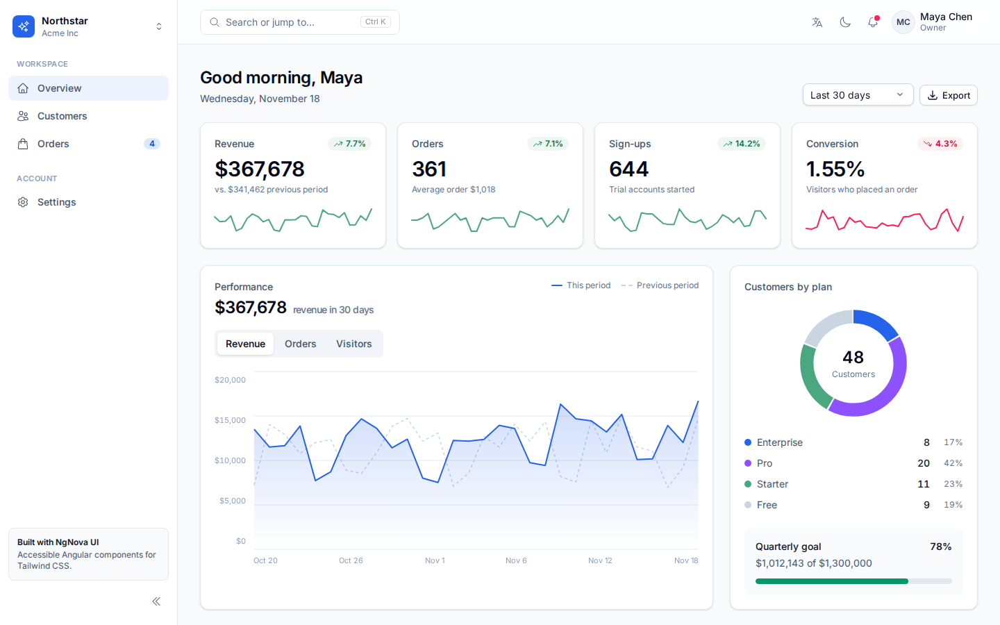
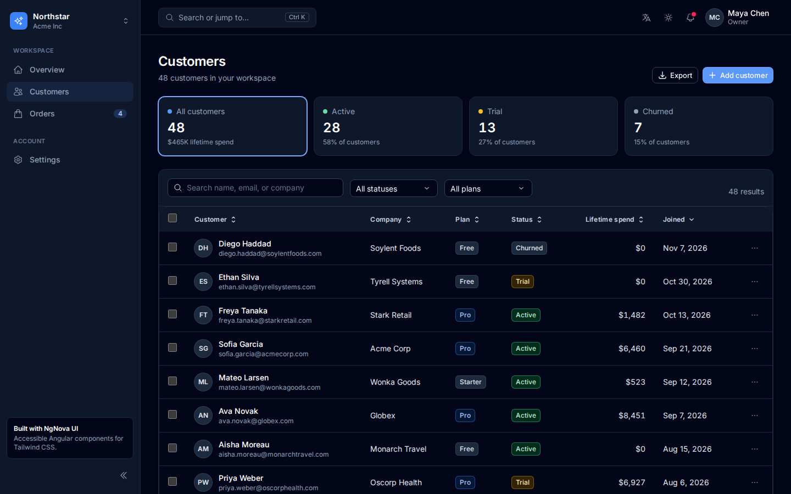
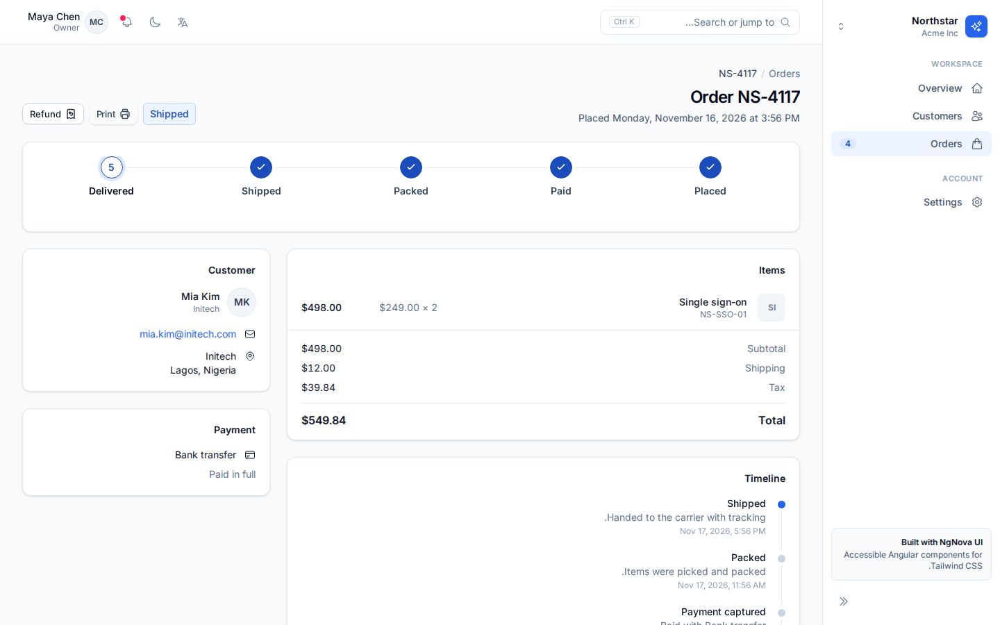
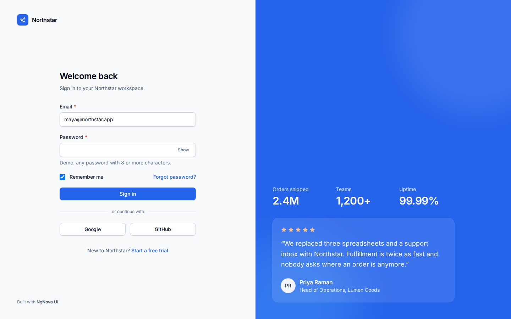

# Northstar Admin

A free, MIT-licensed admin dashboard starter for **Angular 22**, built with
[NgNova UI](https://chiragpatel273.github.io/ngnova-ui/) and **Tailwind CSS v4**.

**[Live demo](https://chiragpatel273.github.io/ngnova-ui/templates/admin/)** ·
[Open in StackBlitz](https://stackblitz.com/github/chiragpatel273/ngnova-ui/tree/main/templates/admin) ·
[NgNova UI docs](https://chiragpatel273.github.io/ngnova-ui/)



## Start a project

```bash
npx degit chiragpatel273/ngnova-ui/templates/admin my-admin
cd my-admin
npm install
npm start
```

Open http://localhost:4200. The template depends on the published `@ngnova/ui` package and has no
ties to the NgNova repository, so the folder is yours to rename and grow.

| Script          | What it does                                             |
| --------------- | -------------------------------------------------------- |
| `npm start`     | Development server with live reload.                     |
| `npm run build` | Production build in `dist/northstar-admin`.              |
| `npm test`      | Unit tests with Vitest through the Angular test builder. |

## What's inside

| Page              | Highlights                                                                                                             |
| ----------------- | ---------------------------------------------------------------------------------------------------------------------- |
| **Overview**      | KPI sparklines, period selector, revenue/orders/visitors chart, plan donut, top products, channels, recent orders.     |
| **Customers**     | Search, status and plan filters with chips, sorting, pagination, bulk export and delete, detail drawer, add/edit form. |
| **Orders**        | Status tabs with counts, date filter, bulk "mark as shipped", mobile card list.                                        |
| **Order details** | Fulfillment stepper, line items, timeline, refund with typed confirmation.                                             |
| **Sign in**       | Split layout, Signal Forms validation, password reveal, and social sign-in buttons.                                    |
| **Settings**      | Profile with photo upload, team invites, notification preferences, theme and direction.                                |

Across the app:

- **Angular 22 throughout:** standalone components, zoneless change detection, `OnPush`,
  signals, lazy routes, route-input binding, and Signal Forms with validation.
- **Command palette:** press <kbd>Ctrl</kbd> <kbd>K</kbd> (<kbd>⌘</kbd> <kbd>K</kbd> on macOS) to
  jump to pages, customers, orders, and actions.
- **Dark mode:** light, dark, or system, applied before first paint and remembered per browser.
- **Right-to-left:** flip the whole layout from the header or from Settings → Appearance.
- **Accessible:** skip link, landmarks, labelled controls, focus management in overlays, and an
  accessible data table behind every chart.
- **Responsive:** collapsible sidebar on desktop, navigation drawer and card lists on mobile.



## Project structure

```
src/app/
  app.config.ts, app.routes.ts   Router, zoneless change detection, page titles
  core/                          Models, mock data, and services (customers, orders, analytics,
                                 team, notifications, preferences)
  layout/                        App shell: sidebar, header, palette, notifications, toasts
  shared/                        Page header, KPI card, SVG line chart, empty state, status colors
  pages/                         overview, customers, orders, settings, not-found
```

## Make it yours

- **Rename the product:** change `APP_NAME` in `src/app/core/title-strategy.ts`, the `<title>`
  in `src/index.html`, and `public/favicon.svg`.
- **Change the navigation:** edit `src/app/layout/navigation.ts` and add a lazy route in
  `src/app/app.routes.ts`.
- **Restyle:** NgNova UI components read the CSS custom properties documented in the
  [theming guide](https://chiragpatel273.github.io/ngnova-ui/theming), and every page uses
  plain Tailwind utilities you can edit in place.
- **Translate:** every NgNova component with built-in text has a typed labels provider, for
  example `provideUiModalLabels({ close: 'Fermer' })`.

## Connect a real API

All data flows through the async services in `src/app/core`. Each method returns a promise, so you
can replace the mock implementation with `HttpClient` without touching the pages:

```ts
// customers.service.ts
private readonly http = inject(HttpClient);

load(): Promise<void> {
  this.loaded ??= firstValueFrom(this.http.get<Customer[]>('/api/customers')).then((customers) => {
    this.state.set(customers);
    this.loadingState.set(false);
  });
  return this.loaded;
}
```

Then add `provideHttpClient()` to `src/app/app.config.ts` and delete `mock-data.ts` and the
`API_LATENCY` token once nothing imports them.

## NgNova UI components used

Alert, Avatar, Button, Checkbox, Chip, Combobox, Command Palette, Confirmation, Date Picker, Divider,
Drawer, File Upload, Input, Menu, Modal, Paginator, Popover, Progress Bar, Radio, Select, Skeleton,
Stepper, Switch, Table, Table State, Tabs, Tag, Textarea, Toast, and Tooltip. See each one in the
[NgNova UI documentation](https://chiragpatel273.github.io/ngnova-ui/).





## License

MIT. Use it for personal and commercial projects. A link back to NgNova UI is appreciated but not
required.
